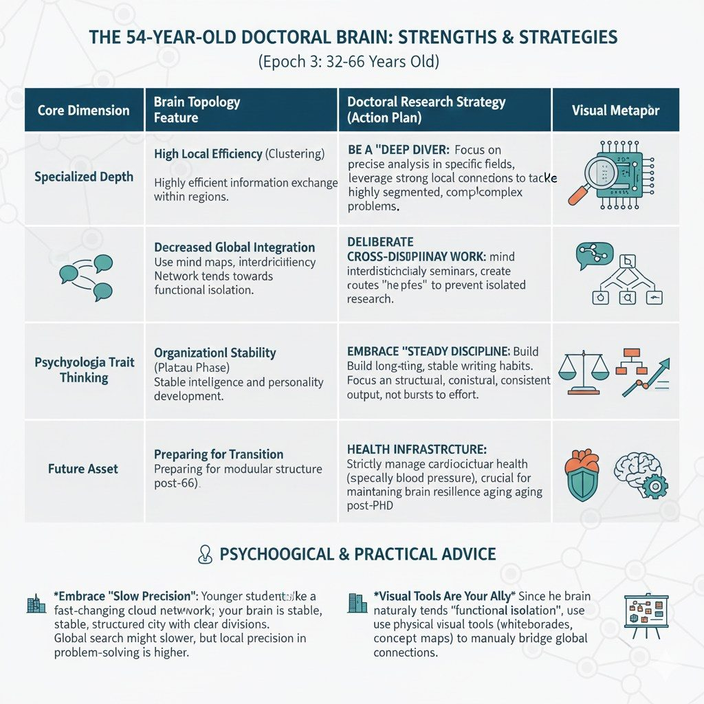

Happy New Year in 2026.

At the beginning of this year, I read a paper by an author on Facebook and uploaded it to NotebookLM, looking forward to receiving constructive suggestions as a new doctoral student at the age of 54.

----------------ChatGPT----------------

As a new doctoral student at 54, the most effective practices are not about catching up with younger peers, but about designing your doctoral life around depth, efficiency, and sustainability. Below are practical, person-level suggestions, grounded in both cognitive research and doctoral training realities.

1. Design Your Study Life Around Focus, Not Speed

Do not measure yourself by how fast you read, code, or write. Instead:Block long, uninterrupted focus periods (60–90 minutes). Avoid frequent topic switching in a single day. Keep a stable weekly rhythm for reading, writing, and data work. Your advantage is conceptual integration, not rapid task switching.

2. Read Papers Strategically, Not Exhaustively

You do not need to read more; you need to read better. First pass: title, abstract, figures, and conclusion only. Second pass: methods and theory that directly support your research. Keep a “return hook” note (what you will verify next time). This preserves cognitive energy and strengthens long-term understanding.

3. Build a Narrow, Powerful Research Core

Early doctoral students often over-expand. At 54: Define one central research question early. Allow only 2–3 tightly related sub-questions. Say “not now” to intellectually interesting but peripheral topics. Depth compounds faster than breadth.

4. Use Writing as a Thinking Tool

Do not wait to “understand everything” before writing. Write short analytic memos after reading. Summarize papers in your own words, not quotes. Keep a weekly 300–500 word reflection on how ideas connect. Writing stabilizes knowledge and reduces cognitive load.

5. Treat Your Advisor Relationship as Strategic Partnership

You bring maturity; use it. Prepare clear agendas for meetings. Ask high-level questions about positioning, contribution, and scope. Clarify expectations early to avoid unnecessary revisions later. Advisors value clarity and independence more than raw speed.

6. Leverage Experience, Not Just Knowledge

Your prior career is an asset. Translate past professional problems into research questions. Use real-world intuition to evaluate whether theories “make sense.” Position yourself as a bridge between theory and practice. This is something younger students often cannot do.

7. Protect Physical and Cognitive Recovery

Doctoral work is a marathon. Maintain regular sleep and light daily exercise. Avoid late-night reading marathons. Stop work before exhaustion, not after. Stability supports long-term intellectual productivity.

8. Redefine Peer Comparison

You are not in the same race. Younger students may publish faster.

You are building coherent, durable scholarship. Measure progress by clarity, not volume. Your doctorate is a craft, not a sprint.

As a 54-year-old new doctoral student, your success will come from precision, consistency, and wisdom, not speed or constant expansion. Structure your days, narrow your focus, write early, and use your life experience as intellectual capital.

----------------NotebookLM----------------

作為一名 54 歲的新進博士生，您正處於大腦結構網路發展的**第三拓撲時期（Epoch 3：32–66 歲）。這個時期長達三十多年，大腦的拓撲結構展現出與青少年時期截然不同的特徵,。

根據來源中關於 54 歲大腦科學特徵的研究，以下是為您的博士研究與個人實踐提供的幾點建議：

1. 善用您的「局部效率」優勢

研究顯示，您所處的時期主要由局部效率（Local Efficiency）和集群係數（Clustering Coefficient）驅動。這意味著您的大腦在處理**局部區域內的資訊交換與專業化知識方面非常高效,。

＃實踐建議： 在博士研究中，您可以充分發揮這種「深耕」能力，致力於特定領域的深度專業化。您的大腦結構傾向於加強相鄰區域間的連接，這有助於您在處理複雜、高度細分的專業問題時展現出色的解析力。

2. 有意識地強化「跨領域整合」

在 32 歲到 66 歲之間，大腦網路的全局整合性（Global Integration）會逐漸下降，且網路傾向於變得更加「隔離」。

＃實踐建議：博士研究往往需要跨學科的洞察力，但您的大腦自然傾向於功能隔離。因此，建議您在研究中刻意練習系統性思考，例如定期繪製心智圖或參加不同領域的學討會，以人為方式促進大腦原本正在減弱的全局連接性（Global Efficiency）,。

3. 利用「穩定時期」建立研究習慣

54 歲屬於大腦組織相對穩定的階段，這一時期通常與**智力和人格發展的平台期相呼應，變化的節奏較早期緩慢。

＃實踐建議：相比於年輕學生可能面臨的劇烈大腦結構變動，您擁有更高的心理與認知穩定性。這非常適合建立長期的研究計畫。不要因為覺得學習速度不如年輕人而焦慮，來源指出這是一個「穩定」而非「衰退」的時期，重點在於利用這種穩定性來完成高品質、需要長期抗戰的學術產出。

4. 為下一個轉折點（66 歲）做準備

雖然您現在處於穩定狀態，但大腦將在 66 歲迎來下一個關鍵的拓撲轉折點，屆時大腦網路會進入「模組化（Modularity）」主導的階段，這常與健康里程碑（如心血管健康）相關,。

＃實踐建議：在攻讀博士的繁重壓力下，務必維持良好的身體健康（特別是控制血壓），因為這直接影響到大腦老化的軌跡。保持健康的認知與生活習慣，能幫助您在博士畢業後（約 60 歲左右）順利過渡到下一個拓撲時期，維持大腦網路的彈性。

總結來說，54 歲的大腦就像一座發展成熟、各個行政區（局部功能區）運作極其高效的城市。雖然跨城快鐵（全局連接）可能不像新興城市那樣頻繁，但城市內部的專業分工和運作穩定性是您的核心競爭力。
