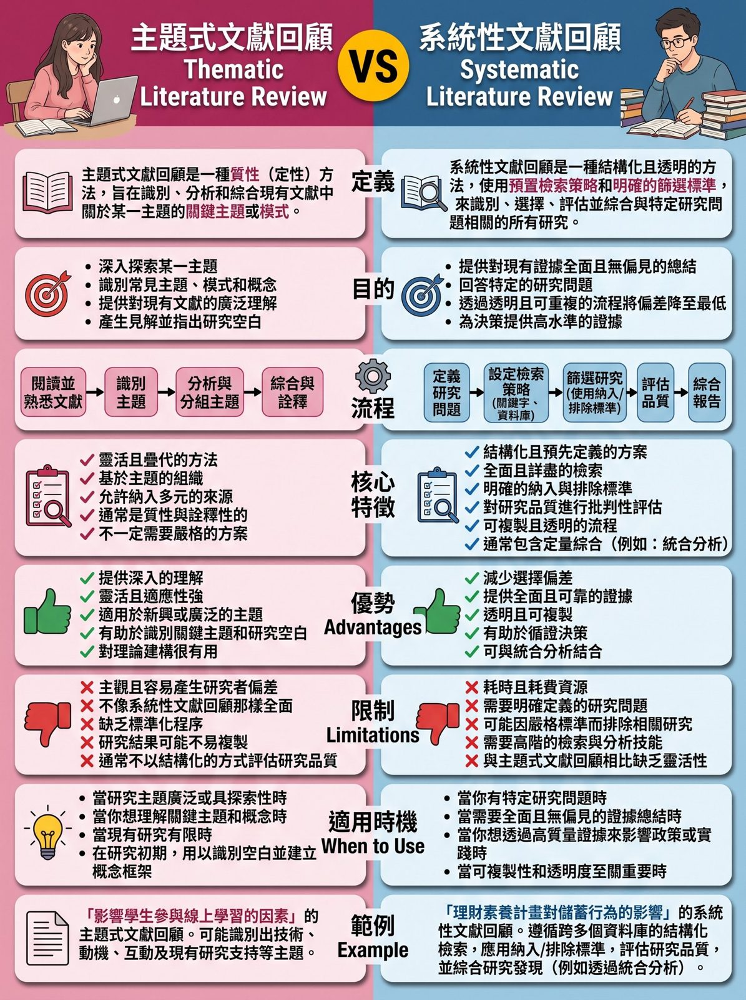

主題式文獻回顧 vs 系統性文獻回顧

Thematic Literature Review vs Systematic Literature Review

1. 定義 (Definition)

* 主題式文獻回顧

* 一種質性取向的方法，旨在從特定主題的現有文獻中，識別、分析與綜合出關鍵主題或模式。

* 系統性文獻回顧

* 一種結構化且高透明度的方法，採用預先定義的檢索策略與明確的篩選標準，對特定研究問題的所有相關文獻進行識別、選取、評估與綜合。

2. 目的 (Purpose)

* 主題式文獻回顧

* 深入探索特定研究主題

* 識別常見主題、模式與概念

* 對現有文獻建立廣泛且整體性的理解

* 產生學術洞察並指出研究缺口

* 系統性文獻回顧

* 提供現有實證全面且無偏見的總結

* 精準回答特定的研究問題

* 透過透明且可重複的程序將偏誤降至最低

* 為決策制定提供高實證等級的依據

3. 流程 (Process)

* 主題式文獻回顧

閱讀並熟悉文獻 → 識別主題 → 分析與歸類主題 → 綜合與詮釋

* 系統性文獻回顧

定義研究問題 → 設定檢索策略（關鍵字/資料庫） → 篩選文獻（納入與排除標準） → 評估研究品質 → 綜合與報告

4. 核心特徵 (Key Features)

* 主題式文獻回顧

* 具靈活性與疊代性（Iterative）的取向

* 以主題（Theme）為核心進行架構組織

* 允許納入多元且不同類型的資料來源

* 多屬質性詮釋與分析

* 不一定需要嚴格預先設定的研究計畫書（Protocol）

* 系統性文獻回顧

* 結構化且預先定義的研究計畫書（Protocol）

* 全面且窮盡式（Exhaustive）的文獻檢索

* 設定明確的納入與排除標準

* 對研究品質進行批判性評估（Critical appraisal）

* 過程具高度可重複性與透明度

* 通常包含量化綜合（如：後設分析 Meta-analysis）

5. 優勢 (Advantages)

* 主題式文獻回顧

* 提供深入的情境理解

* 具高度靈活性與適應性

* 適用於新興或範圍較廣的主題

* 有助於識別核心主題與研究缺口

* 對理論發展與建構具實用價值

* 系統性文獻回顧

* 有效減少選擇性偏誤（Selection bias）

* 提供全面且可靠的實證依據

* 過程高透明度且可精準重複驗證

* 適用於實證導向（Evidence-based）的決策

* 可結合後設分析（Meta-analysis）進行統計整合

6. 限制 (Limitations)

* 主題式文獻回顧

* 具主觀性，較易受研究者個人偏見影響

* 覆蓋面不如系統性文獻回顧全面

* 缺乏標準化的操作程序

* 研究結果較難以被他人精準複製

* 通常未以結構化方式評估文獻品質

* 系統性文獻回顧

* 耗費大量時間與人力資源

* 需要極為具體且明確的研究問題

* 可能因過於嚴格的篩選標準而遺漏相關研究

* 需要進階的文獻檢索與量化分析技能

* 相較於主題式回顧，靈活性較低

7. 適用時機 (When to Use)

* 主題式文獻回顧

* 當研究主題較廣泛或屬於探索性研究時

* 當欲深入理解關鍵主題與概念時

* 當該領域的現有研究相對有限時

* 在研究初期階段，用以尋找缺口並建構概念架構時

* 系統性文獻回顧

* 當擁有具體且明確的研究問題時

* 當需要全面且無偏見的實證總結時

* 當欲為政策、臨床或實務決策提供高質量依據時

* 當研究的可重複性與高透明度為首要考量時

8. 範例 (Example)

* 主題式文獻回顧

* 關於「影響線上學習學生參與度之因素」的主題式文獻回顧：可從現有文獻中歸納出科技運用、學習動機、師生互動與支持系統等主題。

* 系統性文獻回顧

* 關於「理財素養課程對儲蓄行為之影響」的系統性文獻回顧：跨多個資料庫執行結構化檢索，套用明確的納入/排除標準，評估研究品質，並透過後設分析（Meta-analysis）綜合統計結果。
