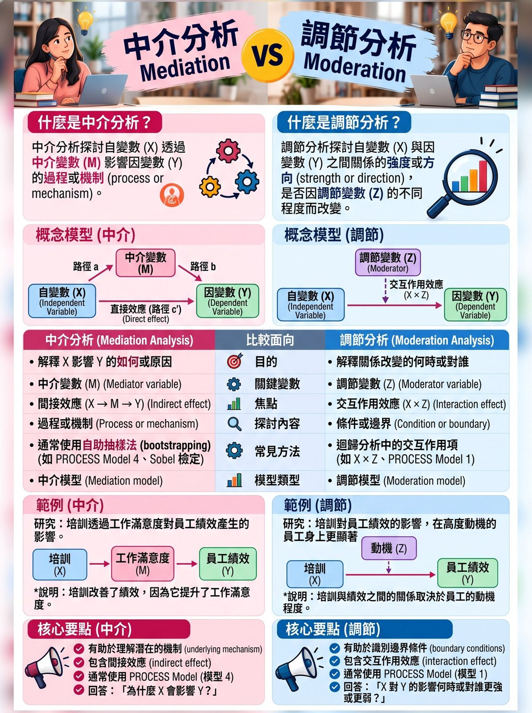

中介分析 vs 調節分析

Mediation Analysis VS Moderation Analysis

一、 定義 (Definition)

* 什麼是中介分析？ (What is Mediation Analysis?)

* 中介分析旨在檢定自變數 (X) 透過中介變數 (M) 影響依變數 (Y) 的過程或內在機制。

* 什麼是調節分析？ (What is Moderation Analysis?)

* 調節分析旨在檢定自變數 (X) 與依變數 (Y) 之間的關係強度或方向，是否會隨著調節變數 (Z) 的水準高低而改變。

四、 實務範例 (Examples)

1. 中介分析範例

* 研究主題：探討員工培訓是否透過「工作滿意度」影響「工作績效」。

* 研究架構：員工培訓(X) → 工作滿意度(M) → 工作績效(Y)

* 結論詮釋：員工培訓能夠提升工作績效，是因為培訓增加了員工的工作滿意度。

2. 調節分析範例

* 研究主題：探討員工培訓對「工作績效」的影響，是否在「高工作動機」的員工身上效果更強。

* 研究架構：員工培訓(X)  →（受「工作動機」(Z) 調節）→  工作績效(Y)

* 結論詮釋：員工培訓與工作績效之間的關係強度，取決於員工本身的動機水準高低。

💡 中介分析 (Mediation Analysis)

1. 有助於理解變數之間運作的潛在機制。

2. 著重於間接效果 (Indirect Effect) 的統計檢定。

3. 在 Hayes PROCESS Model 中常採用 Model 4。

4. 回答的核心問題：「為什麼 X 會影響 Y？」

💡 調節分析 (Moderation Analysis)

1. 有助於釐清理論或現象成立的邊界條件 (Boundary Conditions)。

2. 著重於交互作用效果 (Interaction Effect) 的統計檢定。

3. 在 Hayes PROCESS Model 中常採用 Model 1。

4. 回答的核心問題：「在什麼條件下（或對誰而言），X 對 Y 的影響會增強或減弱？」
