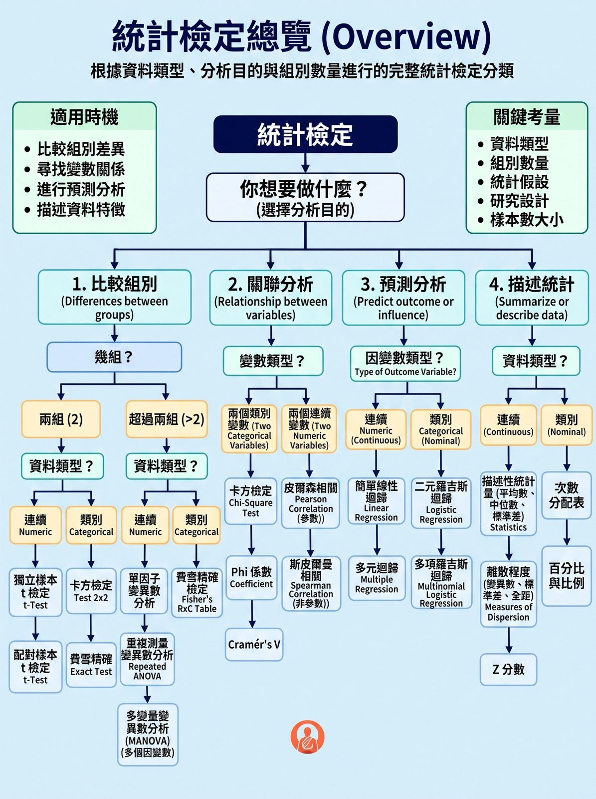

📊 統計檢定選擇指引 📊

做論文研究或數據分析時，最常遇到的卡關點就是：「這組資料到底該用什麼統計方法？」

選錯統計檢定，不僅無理解釋結果，還可能面臨重新跑分析的窘境。

📌 一、 選擇統計檢定的 5 大關鍵考量 (Key Considerations)

在決定使用哪一種統計方法之前，請先確認以下資料特性：

1. 資料類型：屬於「連續型/數值型（Scale/Continuous）」還是「類別型/名義型（Categorical/Nominal）」？

2. 組別數量：是「兩組比較」還是「三組以上比較」？

3. 資料獨立性：數據來自「獨立不同群體」還是「同一批人重複測量/配對」？

4. 統計假設條件：資料是否符合常態分佈（Normality）與變異數同質性（Homogeneity of Variance）？

5. 樣本數大小：樣本數是否足夠支援參數檢定，或需改用非參數檢定？

🧭 二、 四大分析目的與統計檢定決策地圖

▶️ 目的 1：比較組別差異 (Comparing Differences Between Groups)

適合用於檢定不同實驗處理或背景變數在結果上的平均數差異。

【兩組比較 (2 Groups)】

• 連續型資料：

* 獨立樣本：獨立樣本 t 檢定 (Independent-Samples t-Test)

* 配對/前後測：配對樣本 t 檢定 (Paired-Samples t-Test)

• 類別型資料：

* 交叉表：卡方檢定

* 小樣本/格子期待值 < 5：費雪精確檢定 (Fisher's Exact Test)

【三組以上比較 (>2 Groups)】

• 連續型資料：

* 獨立樣本：單因子變異數分析 (One-Way ANOVA)

* 重複測量：重複測量變異數分析 (Repeated Measures ANOVA)

* 多個依變數：多變量變異數分析 (MANOVA)

• 類別型資料：

• R X C 卡方獨立性檢定

▶️ 目的 2：探討變數關聯 (Associating Relationships Between Variables)

適合用於分析兩個變數之間是否存在相關性或相關強度。

• 兩個連續型變數：

* 符合常態分配：皮爾森積差相關 (Pearson Correlation)

* 不符合常態/等級資料：斯皮爾曼等級相關 (Spearman Correlation)

• 兩個類別型變數：

* 卡方檢定 (Chi-Square Test)

* 2 X 2 效果量：Phi 係數 (φ)

* R X C 效果量：Cramér's V 係數

▶️ 目的 3：預測分析與影響效果 (Predicting Outcomes or Influence)

適合用於以自變數 (X) 預測依變數 (Y) 的變化量或影響程度。

• 連續型結果變數：

* 單一預測變數：簡單線性迴歸 (Linear Regression)

* 多個預測變數：多元線性迴歸 (Multiple Regression)

• 類別型結果變數：

* 二分結果（如：成功/失敗）：二元羅吉斯迴歸 (Binary Logistic Regression)

* 多分類結果（如：滿意/中立/不滿意）：多項羅吉斯迴歸 (Multinomial Logistic Regression)

▶️ 目的 4：描述統計與資料摘要 (Describing Data Characteristics)

適合用於呈現研究對象的基本背景與資料分佈特徵。

• 連續型資料：

* 中心趨勢：平均數 (M)、中位數 (Mdn)

* 離散程度：標準差 (SD)、四分位距 (IQR)、變異數 (s^2)、全距 (Range)

* 相對位置：Z 分數 (Z-Score)

• 類別型資料：

* 次數分配表 (Frequency Tables)、百分比 (%) 與比例

📝 三、 APA 格式（第七版）常用統計結果撰寫範例

在撰寫論文結果章節時，請遵循 APA 格式之斜體規範與標點符號設定（統計符號如 M, SD, t, F, p, r 須斜體）：

1. 獨立樣本 t 檢定 (Independent-Samples t-Test)

「檢定結果顯示，實驗組學生的學習成效（M = 85.20, SD = 6.30）顯著高於對照組（M = 78.40, SD = 7.10），t(58) = 3.92, p < .001, Cohen's d = 1.01。」

2. 單因子變異數分析 (One-Way ANOVA)

「不同教學法對學生考試成績有顯著主效果，F(2, 87) = 5.46, p = .006, η² = .11。經 Tukey 事後比較顯示，A 教學法顯著優於 C 教學法（p = .004）。」

3. 皮爾森相關分析 (Pearson Correlation)

「學習動機與學業成就之間呈現顯著的正相關，r(118) = .45, p < .001。」

4. 多元線性迴歸 (Multiple Regression)

「迴歸模型整體具統計顯著性，F(3, 116) = 12.45, p < .001, R² = .24。其中，自我效能能有效正向預測學習成效（β = .38, t = 4.12, p < .001）。」

5. 卡方檢定 (Chi-Square Test)

「性別與產品偏好之間存在顯著關聯，χ²(2, N = 150) = 8.45, p = .015, Cramér's V = .24。」

💡 小提醒：在 APA 格式中，p 值若小於 .001，請直接寫 p < .001，無須寫出小數點後第四位；小數點前若最大值為 1（如 p 值、r、R²、η²），小數點前不加 0（例如寫 .05 而非 0.05）。

圖片來源：https://www.instagram.com/research_monk/

標籤：
