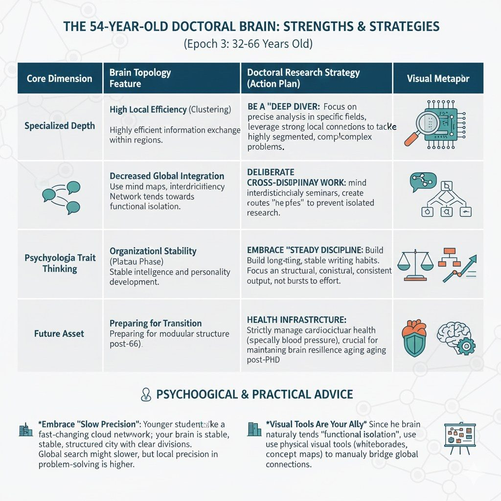

Happy New Year in 2026.

At the beginning of this year, I read a paper by an author on Facebook and uploaded it to NotebookLM, looking forward to receiving constructive suggestions as a new doctoral student at the age of 54.

----------------ChatGPT----------------

As a new doctoral student at 54, the most effective practices are not about catching up with younger peers, but about designing your doctoral life around depth, efficiency, and sustainability. Below are practical, person-level suggestions, grounded in both cognitive research and doctoral training realities.

1. Design Your Study Life Around Focus, Not Speed

Do not measure yourself by how fast you read, code, or write. Instead:Block long, uninterrupted focus periods (60–90 minutes). Avoid frequent topic switching in a single day. Keep a stable weekly rhythm for reading, writing, and data work. Your advantage is conceptual integration, not rapid task switching.

2. Read Papers Strategically, Not Exhaustively

You do not need to read more; you need to read better. First pass: title, abstract, figures, and conclusion only. Second pass: methods and theory that directly support your research. Keep a “return hook” note (what you will verify next time). This preserves cognitive energy and strengthens long-term understanding.

3. Build a Narrow, Powerful Research Core

Early doctoral students often over-expand. At 54: Define one central research question early. Allow only 2–3 tightly related sub-questions. Say “not now” to intellectually interesting but peripheral topics. Depth compounds faster than breadth.

4. Use Writing as a Thinking Tool

Do not wait to “understand everything” before writing. Write short analytic memos after reading. Summarize papers in your own words, not quotes. Keep a weekly 300–500 word reflection on how ideas connect. Writing stabilizes knowledge and reduces cognitive load.

5. Treat Your Advisor Relationship as Strategic Partnership

You bring maturity; use it. Prepare clear agendas for meetings. Ask high-level questions about positioning, contribution, and scope. Clarify expectations early to avoid unnecessary revisions later. Advisors value clarity and independence more than raw speed.

6. Leverage Experience, Not Just Knowledge

Your prior career is an asset. Translate past professional problems into research questions. Use real-world intuition to evaluate whether theories “make sense.” Position yourself as a bridge between theory and practice. This is something younger students often cannot do.

7. Protect Physical and Cognitive Recovery

Doctoral work is a marathon. Maintain regular sleep and light daily exercise. Avoid late-night reading marathons. Stop work before exhaustion, not after. Stability supports long-term intellectual productivity.

8. Redefine Peer Comparison

You are not in the same race. Younger students may publish faster.

You are building coherent, durable scholarship. Measure progress by clarity, not volume. Your doctorate is a craft, not a sprint.

As a 54-year-old new doctoral student, your success will come from precision, consistency, and wisdom, not speed or constant expansion. Structure your days, narrow your focus, write early, and use your life experience as intellectual capital.
