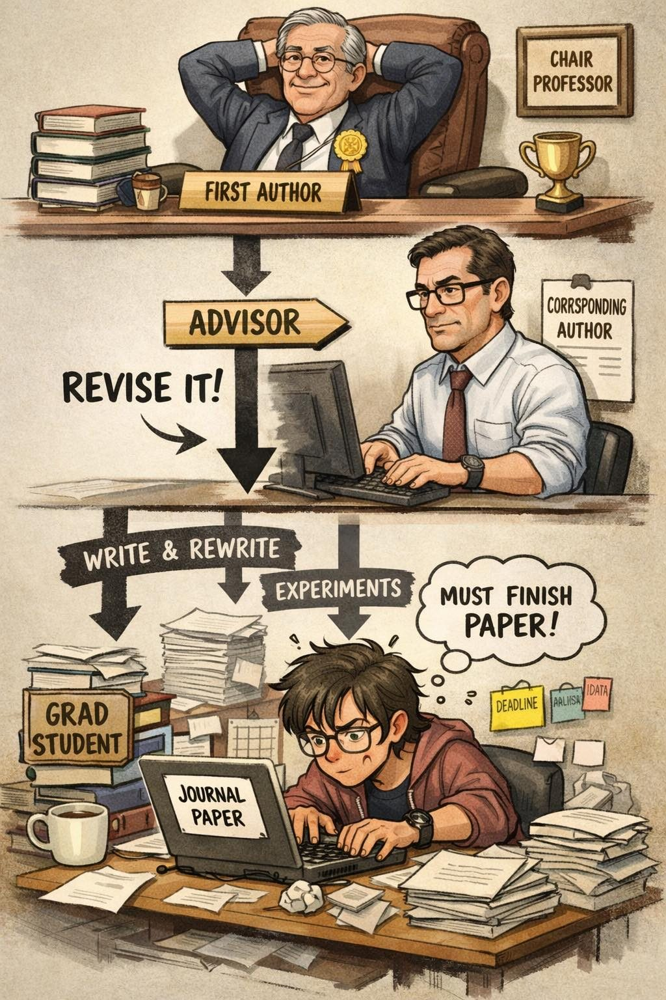

Morning reflections while reading academic papers.

I noticed that in many research articles, the first author is often a chaired or distinguished professor, and the corresponding author is usually the advisor. However, the main content of the journal paper is often written by the graduate students. In order to successfully publish their papers and complete their graduation requirements, graduate students simply accept this arrangement.
