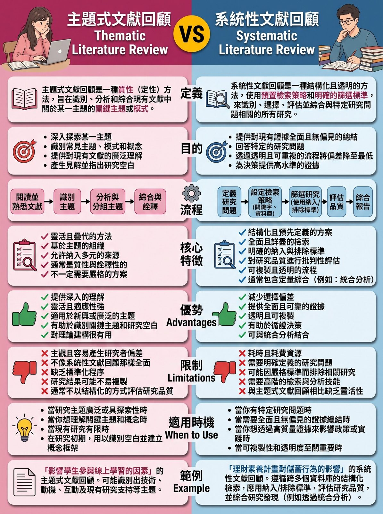

Thematic Literature Review vs Systematic Literature Review

1. Definition

* Thematic literature review

* A qualitative approach that identifies, analyses and synthesises key themes or patterns from existing literature on a particular topic.

* Systematic literature review

* A structured, highly transparent approach that uses a predefined search strategy and explicit selection criteria to identify, select, appraise and synthesise all relevant literature on a specific research question.

2. Purpose

* Thematic literature review

* Explore a particular research topic in depth

* Identify common themes, patterns and concepts

* Build a broad, holistic understanding of existing literature

* Generate scholarly insight and point out research gaps

* Systematic literature review

* Provide a comprehensive, unbiased summary of existing evidence

* Answer a specific research question precisely

* Minimise bias through transparent, reproducible procedures

* Provide high-level evidence for decision-making

3. Process

* Thematic literature review

Read and become familiar with the literature → Identify themes → Analyse and categorise themes → Synthesise and interpret

* Systematic literature review

Define the research question → Set a search strategy (keywords/databases) → Screen studies (inclusion and exclusion criteria) → Appraise study quality → Synthesise and report

4. Key Features

* Thematic literature review

* A flexible and iterative approach

* Organised around themes

* Allows diverse and different types of sources

* Mostly qualitative interpretation and analysis

* Does not necessarily require a strict predefined protocol

* Systematic literature review

* A structured, predefined protocol

* A comprehensive, exhaustive literature search

* Explicit inclusion and exclusion criteria

* Critical appraisal of study quality

* Highly reproducible and transparent process

* Often includes quantitative synthesis (e.g. meta-analysis)

5. Advantages

* Thematic literature review

* Provides in-depth contextual understanding

* Highly flexible and adaptable

* Suited to emerging or broad topics

* Helps identify core themes and research gaps

* Useful for developing and building theory

* Systematic literature review

* Effectively reduces selection bias

* Provides comprehensive, reliable evidence

* Highly transparent and precisely reproducible

* Suited to evidence-based decisions

* Can be combined with meta-analysis for statistical integration

6. Limitations

* Thematic literature review

* Subjective and more prone to the researcher's personal bias

* Less comprehensive coverage than a systematic review

* Lacks a standardised procedure

* Results are harder for others to reproduce precisely

* Usually does not appraise study quality in a structured way

* Systematic literature review

* Consumes a lot of time and labour

* Requires a very specific, well-defined research question

* May miss relevant studies because of overly strict criteria

* Requires advanced literature search and quantitative analysis skills

* Less flexible than a thematic review

7. When to Use

* Thematic literature review

* When the topic is broad or exploratory

* When you want to understand key themes and concepts in depth

* When existing research in the field is relatively limited

* In the early stage of research, to find gaps and build a conceptual framework

* Systematic literature review

* When you have a specific, well-defined research question

* When you need a comprehensive, unbiased summary of evidence

* When you want high-quality evidence for policy, clinical or practical decisions

* When reproducibility and transparency are the top priority

8. Example

* Thematic literature review

* A thematic review of "factors affecting student engagement in online learning" might draw themes such as technology use, learning motivation, teacher-student interaction and support systems from existing literature.

* Systematic literature review

* A systematic review of "the effect of financial literacy courses on saving behaviour" would run structured searches across several databases, apply explicit inclusion/exclusion criteria, appraise study quality, and synthesise statistical results through meta-analysis.
