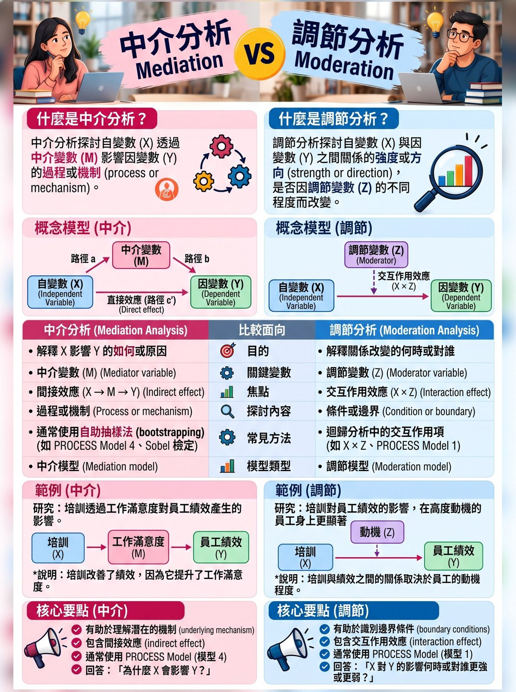

Mediation Analysis VS Moderation Analysis

1. Definition

* What is mediation analysis?

* Mediation analysis tests the process or underlying mechanism through which an independent variable (X) affects a dependent variable (Y) via a mediator (M).

* What is moderation analysis?

* Moderation analysis tests whether the strength or direction of the relationship between an independent variable (X) and a dependent variable (Y) changes depending on the level of a moderator (Z).

4. Examples

1. Mediation example

* Research topic: Does employee training affect "job performance" through "job satisfaction"?

* Model: Employee training (X) → Job satisfaction (M) → Job performance (Y)

* Interpretation: Employee training improves job performance because training increases employees' job satisfaction.

2. Moderation example

* Research topic: Is the effect of employee training on "job performance" stronger for employees with "high work motivation"?

* Model: Employee training (X) → (moderated by "work motivation" (Z)) → Job performance (Y)

* Interpretation: The strength of the relationship between training and performance depends on the employee's own level of motivation.

💡 Mediation Analysis

1. Helps us understand the underlying mechanism between variables.

2. Focuses on statistical tests of the indirect effect.

3. Commonly uses Model 4 in Hayes PROCESS.

4. The core question it answers: "Why does X affect Y?"

💡 Moderation Analysis

1. Helps clarify the boundary conditions under which a theory or phenomenon holds.

2. Focuses on statistical tests of the interaction effect.

3. Commonly uses Model 1 in Hayes PROCESS.

4. The core question it answers: "Under what conditions (or for whom) does the effect of X on Y become stronger or weaker?"
