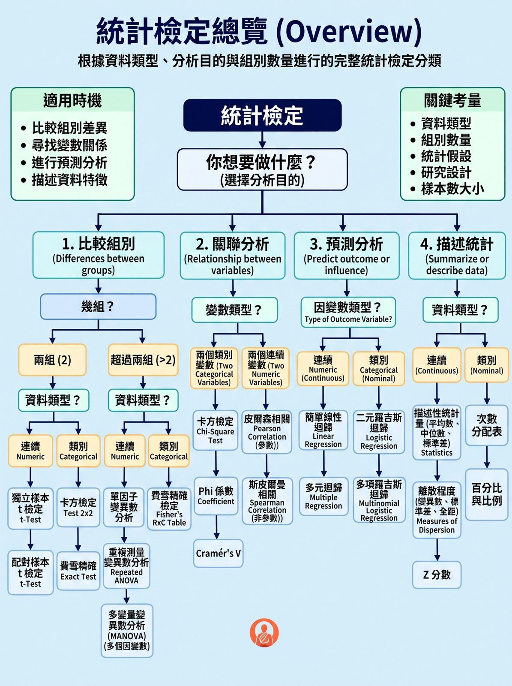

📊 A Guide to Choosing Statistical Tests 📊

When doing thesis research or data analysis, the most common sticking point is: "Which statistical method should I actually use for this data?"

Choosing the wrong test not only makes the results impossible to explain, it may also mean having to run the analysis all over again.

📌 1. Five Key Considerations

Before deciding which statistical method to use, first check these characteristics of your data:

1. Data type: Is it scale/continuous or categorical/nominal?

2. Number of groups: Are you comparing two groups or three or more?

3. Independence: Do the data come from independent, different groups, or from repeated measures/pairs of the same people?

4. Assumptions: Do the data meet normality and homogeneity of variance?

5. Sample size: Is the sample large enough for a parametric test, or do you need a non-parametric test?

🧭 2. Four Analysis Goals and a Decision Map

▶️ Goal 1: Comparing Differences Between Groups

Used to test mean differences in outcomes across different treatments or background variables.

[Two groups]

• Continuous data:

* Independent samples: Independent-Samples t-Test

* Paired/pre-post: Paired-Samples t-Test

• Categorical data:

* Cross-tabulation: Chi-square test

* Small samples/expected cell counts < 5: Fisher's Exact Test

[Three or more groups]

• Continuous data:

* Independent samples: One-Way ANOVA

* Repeated measures: Repeated Measures ANOVA

* Multiple dependent variables: MANOVA

• Categorical data:

• R × C chi-square test of independence

▶️ Goal 2: Associating Relationships Between Variables

Used to analyse whether two variables are related, and how strongly.

• Two continuous variables:

* Normally distributed: Pearson Correlation

* Not normal/ranked data: Spearman Correlation

• Two categorical variables:

* Chi-Square Test

* 2 × 2 effect size: Phi coefficient (φ)

* R × C effect size: Cramér's V

▶️ Goal 3: Predicting Outcomes or Influence

Used to predict the change in, or degree of influence on, a dependent variable (Y) from independent variables (X).

• Continuous outcome:

* One predictor: Simple Linear Regression

* Several predictors: Multiple Regression

• Categorical outcome:

* Binary outcome (e.g. success/failure): Binary Logistic Regression

* Multi-category outcome (e.g. satisfied/neutral/dissatisfied): Multinomial Logistic Regression

▶️ Goal 4: Describing Data Characteristics

Used to present participants' background and the distribution of the data.

• Continuous data:

* Central tendency: mean (M), median (Mdn)

* Dispersion: standard deviation (SD), interquartile range (IQR), variance (s^2), range

* Relative position: Z-score

• Categorical data:

* Frequency tables, percentages (%) and proportions

📝 3. Writing Common Statistical Results in APA Style (7th Edition)

When writing the results chapter, follow APA rules for italics and punctuation (statistical symbols such as M, SD, t, F, p and r are italicised):

1. Independent-Samples t-Test

"The results showed that the learning outcomes of students in the experimental group (M = 85.20, SD = 6.30) were significantly higher than those of the control group (M = 78.40, SD = 7.10), t(58) = 3.92, p < .001, Cohen's d = 1.01."

2. One-Way ANOVA

"Teaching method had a significant main effect on students' test scores, F(2, 87) = 5.46, p = .006, η² = .11. Tukey post hoc comparisons showed that Method A was significantly better than Method C (p = .004)."

3. Pearson Correlation

"There was a significant positive correlation between learning motivation and academic achievement, r(118) = .45, p < .001."

4. Multiple Regression

"The regression model was statistically significant overall, F(3, 116) = 12.45, p < .001, R² = .24. Self-efficacy significantly and positively predicted learning outcomes (β = .38, t = 4.12, p < .001)."

5. Chi-Square Test

"There was a significant association between gender and product preference, χ²(2, N = 150) = 8.45, p = .015, Cramér's V = .24."

💡 Tip: In APA style, if p is smaller than .001, simply write p < .001; there is no need to give the fourth decimal place. For values that can never exceed 1 (such as p, r, R² and η²), don't put a 0 before the decimal point (write .05, not 0.05).

Image source: https://www.instagram.com/research_monk/
